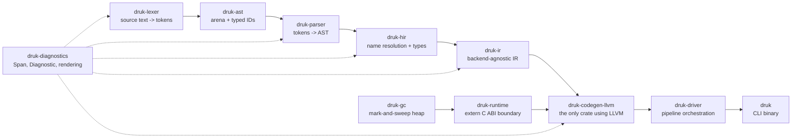

# Architecture

Druk is a layered Cargo workspace. Each phase of the compilation pipeline is its own crate, with
strictly one-directional dependencies — no crate depends on anything to its right in the pipeline
below, and nothing downstream of `druk-ir` leaks back upstream.



## Crate layout

```text
crates/
  druk-diagnostics/   Span, Diagnostic, Label — zero deps on any other Druk crate
  druk-lexer/          source text -> token stream (logos, Tibetan script aware)
  druk-ast/            syntax tree: arena + typed IDs
  druk-parser/         token stream -> AST (hand-written recursive descent + Pratt)
  druk-hir/            AST -> HIR: name resolution + type checking
  druk-ir/             HIR -> backend-agnostic IR, defines `trait CodegenBackend`
  druk-codegen-llvm/   implements CodegenBackend with inkwell — the ONLY crate depending on LLVM
  druk-gc/             mark-and-sweep heap, handle-based (no raw pointers between objects)
  druk-runtime/        array/string ops called via extern "C" from generated code
  druk-driver/         orchestrates lex -> parse -> hir -> ir -> codegen, aggregates diagnostics
  druk/                CLI binary (clap) — zero compiler logic of its own
```

Dependency rule: each crate depends only on the crates to its left in the pipeline above (plus
`druk-diagnostics`, which everything may depend on). `druk-codegen-llvm` and `druk-gc`/
`druk-runtime` are siblings, not a chain — both are pulled in by `druk-driver`, neither depends on
the other.

## The `CodegenBackend` trait is the port boundary

```rust
pub trait CodegenBackend {
    fn compile_module(&mut self, module: &ir::Module) -> Result<CompiledArtifact, Diagnostic>;
}
```

This plays the same role a port trait plays in hexagonal architecture: it's owned by `druk-ir`,
implemented by `druk-codegen-llvm`. Everything upstream of `druk-ir` — lexer, parser, HIR — never
needs to know LLVM exists. That isolation is what makes a second backend (Cranelift for fast dev
builds, a tree-walking interpreter for a REPL) addable later without touching the frontend, and
it's what keeps every `unsafe`/FFI call concentrated in one crate instead of smeared across the
codebase.

## Frontend data structures: arena + typed IDs, not recursive `Box<Node>`

`druk-ast` and `druk-ir` represent trees as a flat arena (`Vec<Node>`) indexed by newtype IDs
(`struct ExprId(u32);`), the same pattern `rust-analyzer` uses internally. Children are referenced
by ID, not by `Box<Node>` or `&'a Node`:

```rust
pub enum Expr {
    Binary { op: BinaryOp, lhs: ExprId, rhs: ExprId },
    Literal(Literal),
    Call { callee: ExprId, args: Vec<ExprId> },
}
```

This sidesteps Rust's recursive-ownership friction entirely (no lifetime juggling, no
`Rc<RefCell<_>>` for a tree that needs to be walked and occasionally mutated), and makes
snapshot-testing trivial (an ID is just a number, a whole arena is `Debug`-printable).

## The runtime ABI boundary: pointers, not platform-specific calling conventions

Every Druk runtime value crossing from LLVM-generated code into `druk-runtime`'s `extern "C"`
functions is represented as `RtValue`, a `#[repr(C)] { tag: i64, payload: i64 }` struct. Every
function that takes or returns one does so through an explicit pointer (`*const RtValue` in,
`*mut RtValue` out) rather than by value.

This matters because a 16-byte struct is passed/returned differently depending on the target's C
ABI: Windows x64 returns it through a hidden `sret` pointer and passes it by a caller-made
(`byval`) copy, while the x86-64 SysV ABI (Linux, macOS) returns and passes the same struct
directly in two registers. An earlier version of `druk-codegen-llvm` hardcoded the Windows
convention, which crashed immediately on Linux. Passing everything through a plain pointer removes
the ambiguity: a pointer is passed in a register the same way on every platform, so
`druk-codegen-llvm` never has to special-case the target OS.

Calls between two Druk-generated functions don't need this: LLVM lowers a bare struct
parameter/return the same way on both ends of a call it compiles itself, since both sides are
generated by the same codegen pass in the same process.

## Garbage collection: mark-and-sweep with explicit root frames

`druk-gc`'s `Heap` is a non-moving mark-and-sweep collector over a `Vec`-backed slot table with a
free list, the same shape a textbook mark-and-sweep uses (see Crafting Interpreters' GC chapter).
Since objects are addressed by `Handle` (an index) rather than a raw pointer, there's no
pointer-invalidation problem a moving/compacting collector would need to solve.

The hard part for any GC on top of LLVM-generated code is finding the root set: LLVM carries no
stack maps `druk-gc` could scan to discover which locals are currently live. Instead,
`druk-codegen-llvm` emits explicit root registration, Lua-style:

- Every function stores its locals in one contiguous `alloca` array and calls
  `druk_rt_push_frame(ptr, count)` right after setting it up, paired with
  `druk_rt_pop_frame()` immediately before every one of that function's return points. This
  roots every active call frame's locals, including recursive calls.
- `compile_rooted_siblings` applies the same push/pop pattern to a list of sub-expressions
  evaluated before any of them is consumed (an array literal's elements, a call's arguments, a
  binary expression's operands), so a later sibling's own allocation can't collect an earlier one
  that hasn't been stored into a local yet.

`druk-runtime` keeps the stack of registered frames and checks `Heap::should_collect()` (a
threshold-and-grow heuristic, the same one `clox` and Lua use) before `druk_rt_make_string`/
`druk_rt_make_array` allocate.

## `lib.rs` is a thin entry point, never where the logic lives

Within a crate, `lib.rs` (or `main.rs` for `druk`) holds `mod` declarations, `pub use`
re-exports, and at most the crate's single top-level entry function — not the implementation
behind it. `druk-parser` splits into `statements.rs` / `expressions.rs` / `patterns.rs`;
`druk-codegen-llvm` splits into `runtime_fns.rs` (the `extern "C"` declarations) and `codegen.rs`
(`CodeGen` and its `compile_*` methods). This is how `rustc`'s own internal crates, `serde`, and
`tokio` are organized, and it's the trigger to check whenever a single file is pushing 400-500
lines.

## Where the GC and runtime live

`druk-gc` is infrastructure (a heap), `druk-runtime` is the set of operations Druk programs call
into at runtime — keep them as two crates, not one, the same way a web backend keeps its DB pool
separate from the use-cases that call it. `druk-runtime`'s functions are `extern "C" fn` so
`druk-codegen-llvm` can `declare` and call them from generated LLVM IR; `druk-runtime` is the only
crate (besides `druk-codegen-llvm` itself) that needs to know the ABI details of the generated
code.
