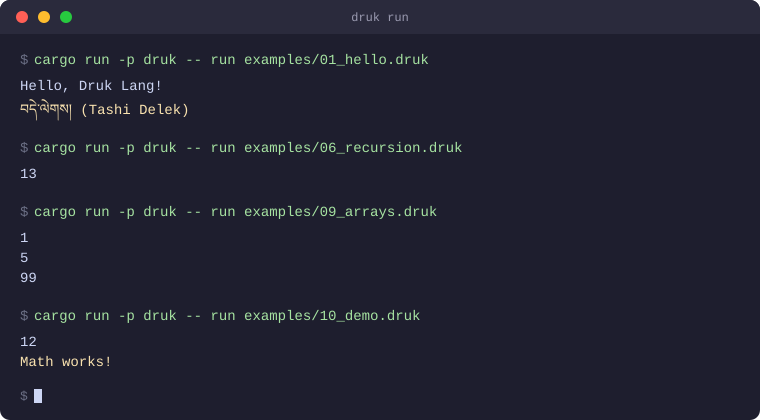

<div align="center">

# Druk

**A programming language whose keywords, identifiers, and numerals are written in Dzongkha, Bhutan's national language.**

[](https://github.com/Etoile-Bleu/druk-lang-v2/actions/workflows/ci.yml)


**[Language reference](docs/dzongkha_reference.md) ([EN](docs/dzongkha_reference_en.md)) · [Font & keyboard setup](docs/dzongkha_input_setup_en.md) · [Architecture](ARCHITECTURE.md) · [Contributing](CONTRIBUTING.md)**



</div>

## Contents

- [What it is](#what-it-is)
- [Example](#example)
- [Installing a prebuilt binary](#installing-a-prebuilt-binary)
- [Quick start](#quick-start)
- [Workspace layout](#workspace-layout)
- [Status](#status)
- [Building](#building)
- [Testing](#testing)
- [Contributing](#contributing)
- [License](#license)

## What it is

Druk (འབྲུག་) is a compiled programming language using the Tibetan (Uchen) script for every
keyword, identifier, and numeral, written in Dzongkha rather than English. The goal is to give
Bhutanese students a language that reads in their own script as a stepping stone alongside the
Scratch-then-Python path already used in the national ICT curriculum, not a replacement for it.

This is a from-scratch Rust rewrite of the original C++ implementation
([Etoile-Bleu/druk-lang](https://github.com/Etoile-Bleu/druk-lang)), built as a layered Cargo
workspace instead of a single sprawling source tree, compiling through LLVM.

## Example

```
གྲངས་ x = ༡༠;
གྲངས་ y = ༥;
བཀོད་ x + y;

ལས་འགན་ fib(གྲངས་ n) {
    གལ་སྲིད་ (n <= ༡) སླར་ལོག་ n;
    སླར་ལོག་ fib(n - ༡) + fib(n - ༢);
}
བཀོད་ fib(༧);
```

`གྲངས་` declares a number, `བཀོད་` prints, `ལས་འགན་` declares a function, `གལ་སྲིད་` is `if`,
`སླར་ལོག་` is `return`, and `༡༠`/`༥`/`༧` are Tibetan digits. See
[docs/dzongkha_reference.md](docs/dzongkha_reference.md) (also available [in
English](docs/dzongkha_reference_en.md)) for the full keyword table and
[examples/](examples/) for runnable programs covering arithmetic, control flow, loops, functions,
recursion, lambdas, pattern matching, arrays, and structs. If Dzongkha text doesn't render as
clean stacked letters in your editor or terminal, see
[docs/dzongkha_input_setup_en.md](docs/dzongkha_input_setup_en.md) (also available [in
French](docs/dzongkha_input_setup.md)) for a font and keyboard/IME setup guide covering Windows,
macOS, and Linux.

## Installing a prebuilt binary

Every [release](https://github.com/Etoile-Bleu/druk-lang-v2/releases) attaches a Linux and a
Windows binary, no local LLVM or Rust toolchain required. The install script downloads the
latest release, verifies its checksum against the `SHA256SUMS.txt` published alongside it, and
puts `druk` on your `PATH`:

```sh
# Linux
curl -fsSL https://raw.githubusercontent.com/Etoile-Bleu/druk-lang-v2/main/install.sh | sh
```

```powershell
# Windows (PowerShell)
irm https://raw.githubusercontent.com/Etoile-Bleu/druk-lang-v2/main/install.ps1 | iex
```

There is no macOS build yet (see the release pipeline's own reasoning: this project statically
links LLVM, which makes an unproven cross-compiled target a real risk). To install by hand
instead, or on a platform the script doesn't cover:

```sh
# Linux x86_64, manual
curl -fsSL -o druk https://github.com/Etoile-Bleu/druk-lang-v2/releases/latest/download/druk-linux-x86_64
chmod +x druk && sudo mv druk /usr/local/bin/
```

```powershell
# Windows, manual
Invoke-WebRequest -Uri "https://github.com/Etoile-Bleu/druk-lang-v2/releases/latest/download/druk-windows-x86_64.exe" -OutFile druk.exe
```

This covers `druk run` (the LLVM JIT) completely: LLVM is statically linked into the binary.
`druk build` (ahead-of-time native compilation) additionally shells out to `llc` and `rustc` at
run time, so it still needs an LLVM 22 install and a Rust toolchain on `PATH` even with a
downloaded binary; see [Building](#building) below for that setup.

## Quick start

```sh
git clone https://github.com/Etoile-Bleu/druk-lang-v2.git
cd druk-lang-v2
# set up LLVM first, see Building below
cargo run -p druk -- run examples/01_hello.druk

# or compile it to a standalone native executable instead of JIT-running it
cargo run -p druk -- build examples/01_hello.druk -o hello
./hello
```

## Workspace layout

```text
crates/
  druk-diagnostics/   spans, diagnostics, ariadne-based rendering
  druk-lexer/          source text -> token stream (logos, Tibetan script aware)
  druk-ast/            syntax tree (arena + typed IDs)
  druk-parser/         token stream -> AST (hand-written recursive descent + Pratt parsing)
  druk-hir/            name resolution + type checking
  druk-ir/             backend-agnostic intermediate representation
  druk-codegen-llvm/   LLVM backend (inkwell), the only crate depending on LLVM
  druk-gc/             mark-and-sweep, handle-based heap
  druk-runtime/        array/string runtime support, the extern "C" ABI boundary
  druk-driver/         pipeline orchestration
  druk/                CLI binary
```

See [ARCHITECTURE.md](ARCHITECTURE.md) for how the pieces fit together and why they're split this
way.

## Status

The full pipeline (lexer, parser, HIR, IR, LLVM codegen, a real mark-and-sweep GC) runs end to end
on both Linux and Windows, verified by CI, through either of two backends: `druk run` JIT-executes
a `.druk` file directly, and `druk build` compiles it ahead-of-time to a standalone native
executable (via `llc` for object emission and `rustc` for the final link against `druk-runtime`,
both of which need to be on `PATH`; see Building below). All 21 bundled `examples/*.druk` programs
compile and execute correctly through both paths, including structs, closures that capture a
variable from their immediately enclosing scope, and the Dzongkha builtins `len`, `push`, `pop`,
`typeof`, `input`, `argv`, and `argc` (`argv`/`argc` reflect the program's own real command-line
arguments: everything after the script path for `druk run`, or a natively-built program's own real
`argv`/`argc` from the OS for a `druk build`-compiled executable).

Known gaps, none of which the bundled examples need:

- `keys`, `values`, and `contains`, which depend on a dictionary/map type this compiler doesn't
  have yet
- Lambdas nested two or more levels deep capturing from further than their immediate enclosing
  scope
- Cross-compilation for `druk build`: it only targets the host it runs on for now
- A language server, editor extension, or web playground

## Building

Requires a recent stable Rust toolchain, plus LLVM 22 for `druk-codegen-llvm` (the only crate that
depends on it, via `inkwell`).

1. Install LLVM 22 with static libraries (a prebuilt `clang+llvm-22.*`/`LLVM-22.*` archive from
   [the LLVM releases page](https://github.com/llvm/llvm-project/releases) works; it must ship
   `bin/llvm-config` and `bin/llc`).
2. Point `llvm-sys` at it: `export LLVM_SYS_221_PREFIX=/path/to/llvm-22.x`, and add its `bin/`
   directory to `PATH` too: `druk build` (native compilation) shells out to `llc` at *run* time,
   not just at `druk-codegen-llvm`'s own build time (`llvm-sys` only needs the prefix env var; the
   `druk` binary itself needs `llc` findable on `PATH` to compile anything). `druk build` also
   shells out to `rustc` to link the final executable, which a normal Rust toolchain install
   already puts on `PATH`.
3. On Windows, some prebuilt LLVM archives list `xml2s.lib` as a system dependency via
   `llvm-config --system-libs` without actually shipping it, which fails the link step with
   `LNK1181`. Work around it with an empty stub library on the linker search path:
   ```sh
   # from an MSVC developer shell, in some empty directory:
   echo "" > empty.c && cl.exe /c empty.c
   lib.exe /OUT:xml2s.lib empty.obj
   export RUSTFLAGS="-L /path/to/that/directory"
   ```
4. Build and test as usual:
   ```sh
   cargo build --workspace
   cargo test --workspace
   cargo run -p druk -- run examples/06_recursion.druk
   ```

Every other crate in the workspace builds and tests without any of the above. See
[.github/workflows/ci.yml](.github/workflows/ci.yml) for exactly how CI automates this setup on
both Linux and Windows.

## Testing

```sh
cargo fmt --check
cargo clippy --workspace --all-targets -- -D warnings
cargo test --workspace
```

Every crate carries unit tests, and `druk-driver`/`druk-codegen-llvm` run the full
`examples/*.druk` suite end to end (parse, check, lower, JIT-execute) as part of `cargo test`.

## Contributing

See [CONTRIBUTING.md](CONTRIBUTING.md) for the git workflow, commit conventions, and code
standards. This project follows a [Code of Conduct](CODE_OF_CONDUCT.md).

## License

MIT, see [LICENSE](LICENSE).
